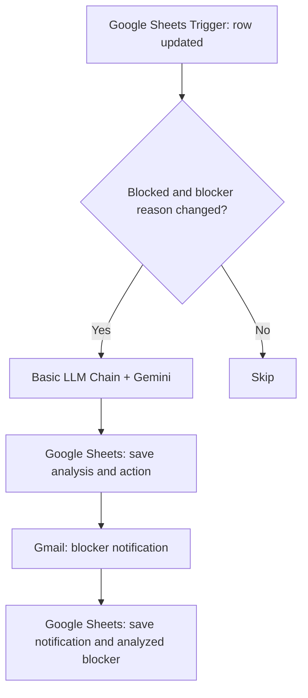
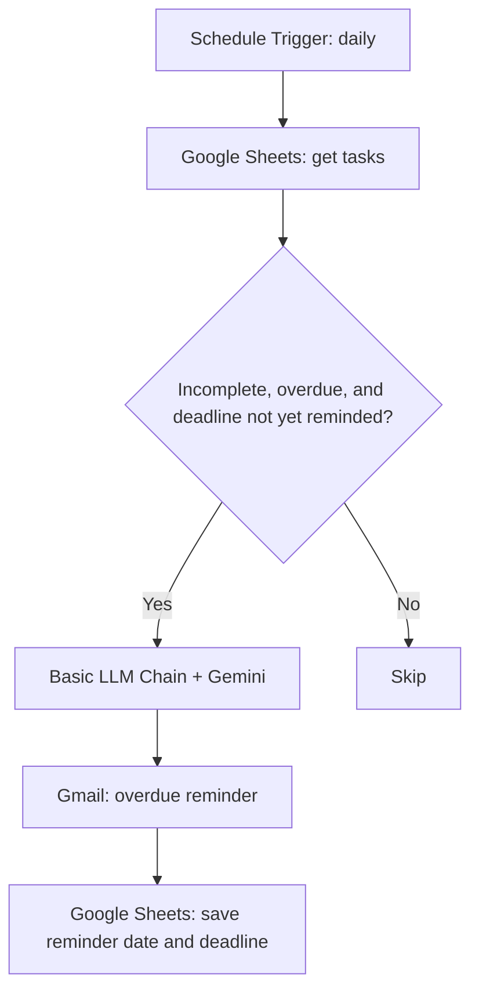
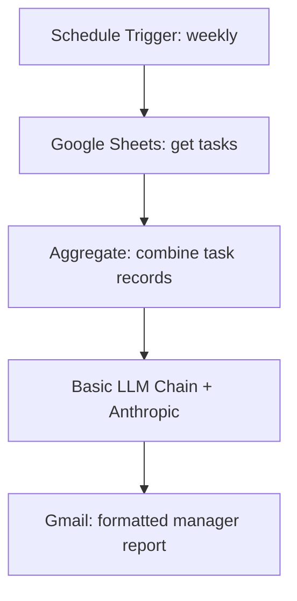
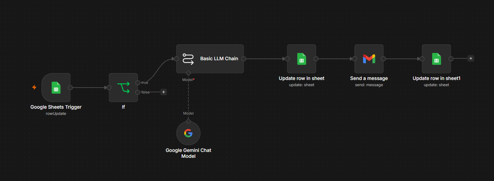
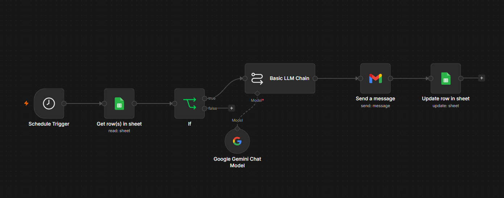
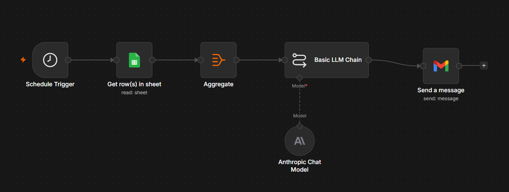

# FlowPilot

### AI-Powered Team Workflow Assistant

**Turn task updates into actionable insights, timely reminders, and manager-ready reports.**

Built with **n8n · Google Sheets · Gmail · Google Gemini · Anthropic**

---

## Overview

**FlowPilot** is a multi-workflow automation project that helps teams monitor tasks without manually chasing every update. It uses **n8n** to connect a shared Google Sheets task tracker with AI-powered analysis and email notifications.

FlowPilot focuses on three common coordination problems: blockers that need attention, deadlines that slip, and the time it takes to prepare a meaningful team progress report.

The project consists of **three independent n8n workflows**, all working with the same task-management spreadsheet.

## Key Features

- **Intelligent blocker detection:** Identifies blocked tasks and asks an AI model to explain dependencies and suggest practical next steps.
- **Changed-blocker awareness:** Reanalyzes a blocked task when its blocker reason differs from the last analyzed reason.
- **Smart overdue reminders:** Checks task deadlines daily and generates personalized email reminders for overdue, incomplete work.
- **Changed-deadline awareness:** Allows another reminder when an overdue task's deadline differs from the deadline previously notified.
- **Weekly management reports:** Consolidates team tasks into an AI-generated report with status counts, blockers, overdue items, risks, and recommended actions.
- **Notification tracking:** Writes reminder and notification metadata back to Google Sheets.
- **Readable HTML emails:** Sends formatted messages, including a color-coded project health section in weekly reports.

## How It Works

### Workflow 01 — Intelligent Blocker Detection



**Purpose:** Surface blockers with useful context, not just a generic alert.

When a task is blocked and its current blocker reason differs from `Last_Analyzed_Blocker`, FlowPilot generates an analysis and recommended action. It stores the result, emails the assigned person, and records the blocker reason that was processed.

### Workflow 02 — Smart Deadline Monitoring



**Purpose:** Identify overdue work and send context-aware reminders.

The workflow checks tasks every day, excludes completed work, and compares each deadline against the last reminded deadline. It sends an AI-written reminder when an overdue deadline has not yet been notified, then updates the tracking fields.

### Workflow 03 — AI Team Progress Reports



**Purpose:** Turn the team's task data into a concise weekly management briefing.

The report covers task status totals, overdue work, important blockers, priority risks, suggested management actions, and an overall **Green / Amber / Red** health assessment. The email uses a color-coded HTML section for project health.

> AI-generated summaries should be reviewed against the source task data before making consequential decisions. In this version, report statistics are generated by the language model rather than a separate deterministic calculation step.

## Technology Stack

| Technology | Role |
|---|---|
| **n8n** | Workflow orchestration, triggers, conditional routing, and integrations |
| **Google Sheets** | Shared task tracker and notification state |
| **Google Gemini** | Blocker analysis and overdue reminder generation |
| **Anthropic** | Weekly team progress report generation |
| **Gmail** | Automated notification and report delivery |
| **GitHub** | Version control and workflow documentation |

## Task Tracker Structure

The workflows use a Google Sheets tab named **`Tasks`** with these columns:

| Column | Field | Purpose |
|---|---|---|
| A | `Task_ID` | Unique task identifier |
| B | `Task_Name` | Short task title |
| C | `Description` | Task details |
| D | `Assigned_To` | Responsible team member |
| E | `Email` | Notification recipient |
| F | `Deadline` | Due date |
| G | `Status` | Not Started, In Progress, Blocked, or Completed |
| H | `Priority` | Low, Medium, High, or Critical |
| I | `Blocker_Reason` | Current blocker details |
| J | `AI_Analysis` | Generated blocker assessment |
| K | `Suggested_Action` | Recommended next step |
| L | `Last_Notification` | Latest blocker notification timestamp |
| M | `Escalation_Status` | Notification/escalation tracking label |
| N | `Deadline_Reminder_Sent` | Whether a deadline reminder was recorded |
| O | `Deadline_Reminder_Date` | Date the reminder was sent |
| P | `Last_Analyzed_Blocker` | Blocker reason last processed |
| Q | `Last_Reminded_Deadline` | Deadline associated with the last reminder |

The workflow examples expect the same column names. Deadline values are interpreted as **MM/DD/YYYY** in the configured deadline logic.

## Repository Structure

```text
flowpilot-ai/
├── workflows/
│   ├── 01-intelligent-blocker-detection.json
│   ├── 02-smart-deadline-monitoring.json
│   └── 03-ai-team-progress-reports.json
├── screenshots/
│   ├── workflow-01.png
│   ├── workflow-02.png
│   ├── workflow-03.png
│   └── weekly-report-email.png
├── README.md
└── LICENSE
```

## Getting Started

### Prerequisites

- An **n8n** instance
- A Google account with access to **Google Sheets** and **Gmail**
- Credentials for the AI providers used by the workflows (**Gemini** and **Anthropic**)
- A Google Sheet with the `Tasks` tab and the columns listed above

### Setup

1. **Clone or download** this repository.
2. In n8n, **import** the three JSON files from `workflows/`.
3. Configure your own **Google Sheets**, **Gmail**, **Gemini**, and **Anthropic** credentials.
4. In each Google Sheets node, select your own spreadsheet and the **`Tasks`** tab.
5. Review the **workflow timezone** and Schedule Trigger settings:
   - Workflow 01: checks for row updates using its Google Sheets Trigger.
   - Workflow 02: runs **daily at 9:00 AM**.
   - Workflow 03: runs **Mondays at 9:00 AM**.
6. Replace test recipient addresses with **addresses you control**.
7. Test each workflow with a small set of **fictional tasks**.
8. Verify that the final Google Sheets update nodes write notification tracking values correctly.
9. **Publish/activate only after testing** and confirming that scheduled or triggered emails are intended.

> **Privacy and security:** Do not commit OAuth tokens, API keys, private email addresses, spreadsheet IDs, credential references that expose account metadata, or pinned execution data containing personal information. Inspect exported n8n JSON before publishing it.

## Demo Scenarios

| Scenario | Expected behavior |
|---|---|
| A task becomes blocked with a new blocker reason | AI analysis and an email notification are generated |
| A blocked task's reason changes | The changed blocker is analyzed and tracked |
| A task is overdue and incomplete | An AI-generated reminder is sent and recorded |
| The same overdue deadline is checked again | The previously reminded deadline is skipped |
| An overdue task's deadline changes | The new deadline becomes eligible for another reminder |
| Weekly report runs | One consolidated team report is generated and emailed |

## Screenshots

- Workflow 01 canvas showing blocker detection and notification tracking

- Workflow 02 canvas showing overdue detection and reminder tracking

- Workflow 03 canvas showing aggregation, AI reporting, and Gmail

- Final weekly report email 
[Weekly Report](<../Downloads/FlowPilot Report.pdf>)

## Current Limitations

FlowPilot is a **tested learning/portfolio project**, not a fully hardened production notification service.

- **Email delivery is not exactly-once:** If an email succeeds but its tracking update fails, retrying can produce a duplicate.
- **Blocker identity is text-based:** A task blocked again for the *same* reason will be skipped unless the tracking state is reset or the logic is extended.
- **Deadline reminders are deadline-based:** A previously reminded deadline will not generate recurring reminders unless the tracking value changes.
- **Report statistics are AI-generated:** A language model can miscount or infer outdated blocker context.
- **Input and date assumptions:** Deadline parsing currently assumes `MM/DD/YYYY`, and scheduling depends on the n8n workflow timezone.
- **Automatic runs require activation:** The imported workflows must be published/active to execute on their configured triggers.

## Potential Enhancements

- Deterministic task statistics before AI report generation
- Separate notification logs and stronger idempotency controls
- Escalation rules for repeated or critical blockers
- Reminder frequency policies and deadline-change history
- Better handling of reopened tasks and cleared blockers
- Additional monitoring for failed workflow executions

## Project Status

**Three workflows built and manually tested.** Automatic production scheduling is intentionally left disabled until credentials, recipients, and trigger behavior are reviewed.

---

**FlowPilot — Less manual follow-up. More actionable team visibility.**